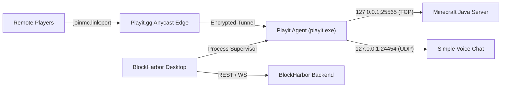

<div align="center">

# ⚓ BlockHarbor

**A Polished Native Windows Application & Management Platform for Minecraft Servers**

Run, monitor, and share Minecraft servers locally on Windows with zero-configuration port forwarding, native process isolation, and a modern desktop experience.

[](https://github.com/seeroy/kubek-minecraft-dashboard)
[](https://github.com/seeroy/kubek-minecraft-dashboard)
[](LICENSE)
[](https://github.com/seeroy/kubek-minecraft-dashboard/releases)

[Features](#-features) · [Playit.gg Integration](#-playitgg-integration) · [Desktop Architecture](#-desktop-architecture) · [Quick Start](#-quick-start) · [Building from Source](#-building-from-source) · [Documentation](#-documentation)

</div>

---

## ✨ Features

### 🖥️ Native Windows Desktop Experience
- **Single-Executable Desktop Shell**: Native WPF host (`BlockHarbor.exe`) utilizing Microsoft Edge WebView2 for fluid UI rendering and minimal memory footprint.
- **System Tray Integration**: Minimize or close to tray with quick status indicators, one-click access to server folders, live logs, and graceful application exit.
- **Single-Instance Protection**: Enforced via global system mutex to prevent multiple instances from corrupting SQLite databases or server world files.
- **Dynamic Port Selection**: Automatically negotiates free loopback ports (8000–8099) on startup to prevent port collisions.
- **Self-Contained Backend**: Bundles NestJS, SQLite, and Next.js frontend VFS into a standalone `BlockHarbor-Backend.exe`—no manual installation of Node.js, Bun, or Python required.

### 🌐 Built-in Playit.gg Zero-Config Tunnels
- **Automated Agent Supervision**: Discovers existing installations or downloads the official `playit-windows-x86_64.exe` agent directly from GitHub releases.
- **One-Click Claim Flow**: Live log streaming detects claim tokens (`https://playit.gg/claim/...`) with in-app browser prompts.
- **8-Step Setup Wizard**: Guided configuration mapping server ports, protocol selection (TCP/UDP), local socket reachability verification, and public address assignment.
- **Simple Voice Chat Guidance**: Specialized advisory detecting Voice Chat mods (UDP port 24454) vs main TCP game ports (25565), preventing common misconfigurations.
- **Comprehensive Diagnostics**: In-depth health checks with pass/fail badges, actionable issue resolution, and system recommendations.

### ⛏️ Native Minecraft Server Management
- **Universal Engine Support**: Vanilla, Paper, Spigot, Purpur, Fabric, Forge, Velocity, Bukkit, and custom server JARs.
- **Native Process Supervision**: Employs Windows process tree management and `taskkill /T /F` rather than Linux Unix signals or Docker requirements.
- **Adoptium Java Discovery**: Automatically detects installed Java versions and pulls compatible runtimes (Java 8, 11, 17, 21, 22) based on server blueprint needs.
- **Real-Time WebSockets**: Live console streaming, interactive command terminal, resource metrics (CPU, RAM, Disks), and player counts via Query protocol.
- **File Manager & Monaco Editor**: Drag-and-drop file uploads, in-browser code editor, archive creation/extraction, and automated world backups.

---

## 🌐 Playit.gg Integration

BlockHarbor includes a first-class, legitimate networking layer powered by the official Playit.gg agent:



1. **No Router Port-Forwarding**: Secure outbound tunnels bypass CGNAT, strict carrier firewalls, and home router limitations.
2. **Local Loopback Probing**: Performs instant TCP loopback connection checks before publishing tunnels to confirm your server is genuinely listening.
3. **Public Endpoint Health Testing**: Resolves DNS and tests end-to-end socket reachability with latency measurements in milliseconds.

---

## 🏗️ Desktop Architecture

```
BlockHarbor/
├── BlockHarbor.exe              # Native .NET 10 WPF + WebView2 Desktop Shell
├── BlockHarbor-Backend.exe      # Compiled Self-Contained Backend (NestJS + SQLite + VFS)
├── WebView2Loader.dll           # Microsoft WebView2 native runtime loader
├── app.ico                      # Multi-resolution application icon
└── data/                        # User state, databases, and server configurations
    ├── kubek.db                 # Primary SQLite database
    ├── servers/                 # Minecraft server directories
    └── backups/                 # Compressed world backups
```

- **Loopback Security**: The backend strictly binds to loopback (`127.0.0.1`), ensuring local APIs are never exposed to external networks.
- **Graceful Shutdown**: Intercepts application close signals to cleanly stop Minecraft servers and child processes without data corruption.

---

## 🚀 Quick Start

### Installation via Setup Wizard
1. Download `BlockHarbor-Setup-x64.exe` from the latest [GitHub Release](https://github.com/seeroy/kubek-minecraft-dashboard/releases).
2. Run the installer. Choose whether to create Desktop and Start Menu shortcuts.
3. Launch **BlockHarbor** from your Start Menu.
4. Log in using the generated admin credentials displayed in the initial startup screen.

### Portable Version
1. Download `BlockHarbor-Portable-x64.zip`.
2. Extract to any folder (e.g. `C:\BlockHarbor`).
3. Double-click `BlockHarbor.exe`.

---

## 🛠️ Building from Source

### Prerequisites
- Windows 10/11 x64
- [.NET 10.0 SDK](https://dotnet.microsoft.com/download/dotnet/10.0)
- [Node.js 20+](https://nodejs.org/) & [Bun 1.3+](https://bun.sh/)
- [Inno Setup 6+](https://jrsoftware.org/isinfo.php) (optional, for building the installer)

### Build Commands

```powershell
# 1. Install dependencies
cd frontend && npm install && cd ..
cd backend && npm install && cd ..

# 2. Build Next.js frontend & generate VFS
cd frontend && npm run build && cd ..
node scripts/generate-vfs.js

# 3. Build NestJS backend bundle
cd backend && npm run build && cd ..

# 4. Compile standalone backend executable
bun run scripts/build.ts -f -b --platform win

# 5. Build native desktop shell (.NET 10 WPF)
dotnet publish desktop/BlockHarbor.Desktop.csproj -c Release -r win-x64 --self-contained false -o dist/desktop

# 6. Copy backend binary to desktop directory
Copy-Item dist/BlockHarbor-Backend.exe dist/desktop/BlockHarbor-Backend.exe -Force

# 7. (Optional) Build Windows Installer
& "C:\Program Files (x86)\Inno Setup 6\iscc.exe" scripts/installer.iss
```

The resulting setup installer will be generated at `dist/release/BlockHarbor-Setup-x64.exe`.

---

## 📖 Documentation

- [Architecture Guide](docs/ARCHITECTURE.md) — Comprehensive technical overview of process supervision, WebView2 container, and IPC.
- [Playit.gg Networking Guide](docs/PLAYIT_GUIDE.md) — Complete walkthrough for remote tunnels and UDP voice chat setup.
- [REST API Reference](openapi.json) — Full OpenAPI 3.1 schema.

---

## 📜 Attribution & License

BlockHarbor is licensed under the [GNU General Public License v3.0 (GPLv3)](LICENSE).

This project is built upon the foundational work of **Kubek Minecraft Dashboard** by **Seeroy** and contributors, transformed into a native Windows desktop experience by the BlockHarbor Team. All original copyright notices, blueprints, and licenses remain preserved.
