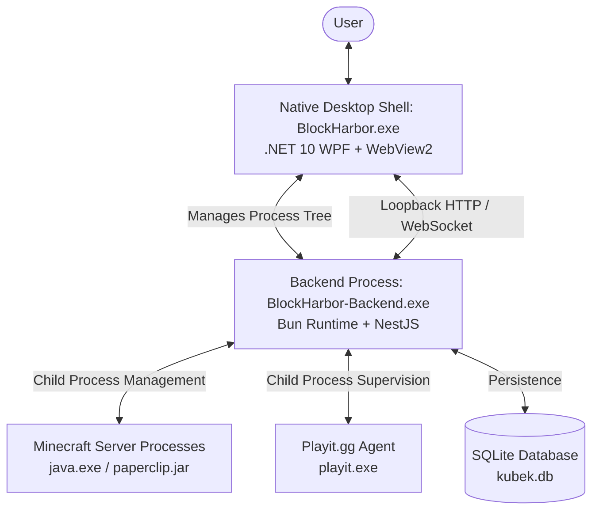
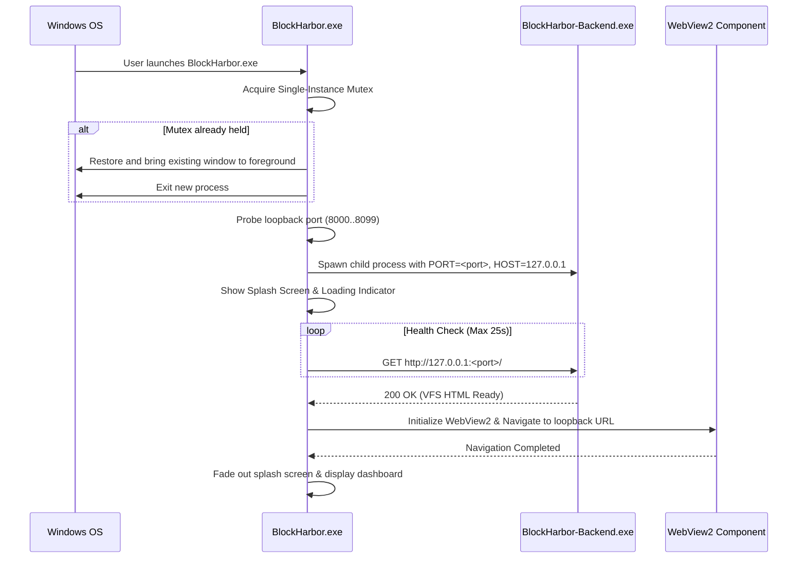

# BlockHarbor Architecture & Engineering Overview

This document describes the architectural design, system boundaries, and process lifecycle of **BlockHarbor**, a native Windows Minecraft server management application.

---

## 1. High-Level Architecture

BlockHarbor is organized into three cooperating layers:



### Key Separation of Concerns
1. **Desktop Shell (`BlockHarbor.exe`)**:
   - Written in C# on .NET 10.0 WPF.
   - Hosts Microsoft Edge WebView2 control.
   - Manages the Windows desktop window, system tray (`NotifyIcon`), single-instance mutex, and background process supervision.
   - Intercepts external navigation requests and routes them to the Windows default web browser.

2. **Self-Contained Backend (`BlockHarbor-Backend.exe`)**:
   - Compiled via Bun into a single self-contained PE32+ executable.
   - Houses the NestJS application, Express HTTP server, Socket.io WebSocket server, and SQLite storage.
   - Serves prerendered Next.js frontend assets directly from an in-memory Virtual File System (VFS).
   - Manages Minecraft child processes, Adoptium Java runtimes, scheduled tasks, and the Playit agent.

3. **Frontend (Next.js 16)**:
   - Built as a static SPA (`output: 'export'`) with Lucide icons, Tailwind CSS, and Radix UI primitives.
   - Communicates with the local backend over loopback (`http://127.0.0.1:<port>`) with JWT authentication.

---

## 2. Process Supervision & Startup Flow



### Port Conflict Handling
If port 8000 is occupied by another local service (e.g., Docker, dev servers, or other panels), `ProcessSupervisor.FindFreePort()` probes subsequent ports up to 8099 and dynamically passes the chosen port to both the backend process and WebView2.

---

## 3. Windows Native Process Management

Unlike UNIX platforms that rely on POSIX signals (`SIGTERM`, `SIGINT`), Windows handles processes hierarchically.

### Graceful Shutdown
1. When a Minecraft server stop command is issued:
   - The backend sends `stop` or `end` to standard input (`stdin`).
   - A 30-second graceful timeout timer begins.
   - If the process does not terminate within the window, the backend executes `taskkill /pid <PID> /T /F` to cleanly terminate the process tree.
2. When the desktop shell closes:
   - All managed backend and agent child processes are terminated using process tree termination to prevent orphaned background tasks.

---

## 4. File Structure on Windows

When installed via the setup wizard, BlockHarbor organizes files as follows:

```
%ProgramFiles%\BlockHarbor\
├── BlockHarbor.exe               # Desktop executable
├── BlockHarbor-Backend.exe       # Standalone backend
├── WebView2Loader.dll            # WebView2 loader
├── app.ico                       # Icon
├── unins000.exe                  # Inno Setup Uninstaller
│
└── data\                         # Persistent User Data
    ├── kubek.db                  # SQLite database
    ├── servers\                  # Server instances
    │   └── <server-id>\
    │       ├── server.properties
    │       ├── world\
    │       └── server.jar
    ├── binaries\
    │   ├── java\                 # Adoptium JDKs (8, 11, 17, 21)
    │   └── playit\               # Official Playit agent executable
    └── backups\                  # Compressed zip backups
```

### Safe Upgrades & Data Preservation
The Inno Setup installer uses `ignoreversion` flags for executable binaries and explicitly preserves the `data/`, `servers/`, and `backups/` directories across upgrades. During uninstallation, the user is presented with an explicit confirmation dialog asking whether to keep or remove their server worlds and backup archives.
