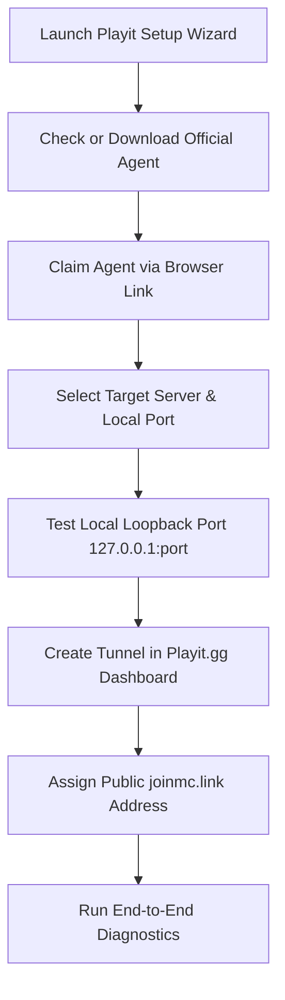

# Playit.gg Integration Guide for BlockHarbor

This guide covers everything you need to know about setting up and operating zero-configuration Minecraft tunnels using **Playit.gg** inside **BlockHarbor**.

---

## 1. What is Playit.gg?

Playit.gg is a global tunneling and proxy service designed for game servers. It eliminates the need for:
- Router port-forwarding (NAT rules)
- Exposing your home public IP address to the internet
- Dealing with Carrier-Grade NAT (CGNAT) or mobile hotspots

BlockHarbor directly integrates with the **official Playit agent binary** (`playit-windows-x86_64.exe`), providing full in-app process management, claim automation, and diagnostic checks.

---

## 2. Quick Setup Workflow

### Step 1: Agent Discovery & Installation
- Click **Playit Network** in the left sidebar.
- If the agent is not installed, click **Download Agent**. BlockHarbor fetches the official release from `https://github.com/playit-cloud/playit-agent/releases/latest`.
- The binary is placed safely in `./binaries/playit/playit.exe`.

### Step 2: Claiming Your Agent
- Once started, the agent outputs a unique claim link to its console (e.g. `https://playit.gg/claim/abc123xyz`).
- BlockHarbor automatically detects this link and surfaces a prominent banner with an **Open Claim Link** button.
- Clicking the button launches your default browser, linking the agent to your Playit.gg account.

### Step 3: Setting Up a Minecraft Tunnel
1. Click **Add Tunnel** or **Setup Wizard**.
2. Select your server (e.g., "Survival World").
3. Set the tunnel type:
   - **Minecraft Java**: TCP port 25565
   - **Minecraft Bedrock**: UDP port 19132
   - **Simple Voice Chat**: UDP port 24454
4. BlockHarbor runs an instant loopback connection check (`127.0.0.1:<port>`) to make sure your Minecraft server is online and accepting connections before continuing.
5. In your Playit.gg web dashboard, add the matching tunnel to your agent.
6. Copy the assigned public hostname (e.g., `emerald-bear.gl.joinmc.link`) and port into BlockHarbor.

---

## 3. Simple Voice Chat (Important Configuration)

The popular **Simple Voice Chat** Minecraft mod uses peer-to-peer audio transmission and **strictly requires UDP packets**.

> [!WARNING] Common Pitfall: Configuring Voice Chat as TCP
> If you create a TCP tunnel for voice chat, players will join the server but will not hear each other or will see a "Voice Chat Not Connected" warning.

### Correct Voice Chat Setup:
1. **Game Tunnel**: `TCP` mapped to `25565` (gives players their `joinmc.link` address).
2. **Voice Chat Tunnel**: `UDP` mapped to `24454` (set in `config/voicechat/voicechat-server.properties` as `port=24454`).
3. Set `bind_address=0.0.0.0` or `127.0.0.1` in your server's voice chat config.
4. Set `voice_host=<playit-public-voice-address>` and `port=<playit-public-voice-port>` in `voicechat-server.properties`.

BlockHarbor's **Diagnostics Panel** automatically checks for voice chat tunnels and warns you if TCP was selected instead of UDP.

---

## 4. Diagnostics & Troubleshooting

Click **Run Diagnostics** on any server in the Playit page to run the automated diagnostic suite:

| Check | Healthy State | Description |
|---|---|---|
| **Minecraft Server Status** | PASS | Checks that the server process is currently running. |
| **Playit Agent Installed** | PASS | Verifies that `playit.exe` is found on disk. |
| **Playit Agent Process** | PASS | Confirms the agent is actively running with an allocated PID. |
| **Playit Agent Claim & Auth** | PASS | Verifies the agent is linked to your Playit.gg account. |
| **Local Port Listener** | PASS | Probes `127.0.0.1:<port>` over TCP to ensure server is listening. |
| **Remote Endpoint Reachable** | PASS | Resolves DNS and connects to the public Playit address. |
| **Voice Chat Protocol** | PASS | Confirms UDP protocol is selected for voice chat ports. |
| **Windows Firewall** | PASS | Confirms outbound tunnel connectivity is unblocked. |

If any check fails, BlockHarbor provides targeted recommendations to resolve the issue in seconds.
